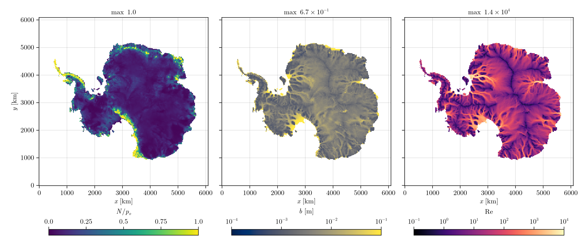

# [Antarctica](@id Antarctica)

The Antarctic Ice Sheet from Yelmo restarts at 32 km and 16 km, the same restarts as the
FastHydrology.jl examples. The default sheet, one year of 1-day steps. The setup is the one of
[Greenland](@ref Greenland): `load_yelmo` in `docs/make_figures.jl`, `RegularizedCoulombSlidingLaw(0.25)`
with Yelmo's basal speed, no surface input. Grounded cells below flotation that connect to the
ocean are set to `OCEAN`, so the grounding line is where Yelmo's ice would float.

| Grid | Cells | Grounded | Steps | `N/p_o` | Mean `N` | Max `b` |
|---|---|---|---|---|---|---|
| 32 km | 191 x 191 | 11 739 | 365 x 1 day | 0 to 1 | 1.87 MPa | 0.26 m |
| 16 km | 381 x 381 | 47 515 | 365 x 1 day | 0 to 1 | 1.78 MPa | 0.67 m |

Wall times are on the [Performance](@ref) page.

## 32 km

## 16 km

Under most of the ice sheet the water pressure is close to the overburden. Near the grounding line
the water drains into the ocean at the ocean's hydrostatic pressure, below the overburden of the
grounded ice, so `N/p_o` rises there. The ice streams carry turbulent flow (`Re` up to about
`10^4`), the interior is laminar.
