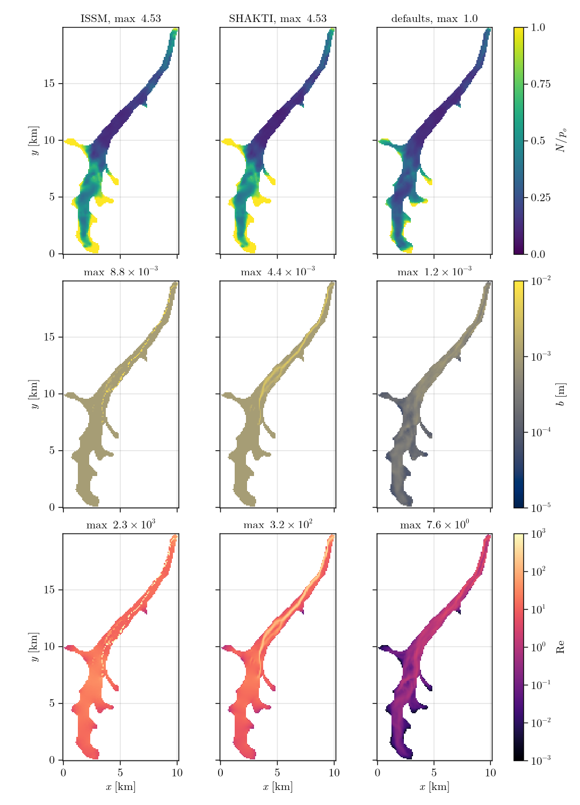

# [Drang Drung Glacier](@id DrangDrung)

The winter hydrology of Drang Drung Glacier, a valley glacier in the western Himalaya, from the
ISSM SHAKTI run of [Thota2026](@cite), rasterized onto a 100 m grid. One year of 1-hour steps,
the length of the ISSM run, with the defaults and with the original SHAKTI equations, against
ISSM's own solution. The loaders are `load_drangdrung` and `load_drangdrung_issm` in
`docs/make_figures.jl`, which also makes the figure; the data is in `test/drangdrung/data_v2`.

* Geometry, `A`, `G` and the friction coefficient from the ISSM model; no sliding, no surface input.
  The water comes from geothermal melt.
* Sliding law: `LinearSlidingLaw` with the uniform `C = 500` of the ISSM run.
* ISSM's constants: `rho_i = 917`, `omega = 1e-3`, `br = 0`, `lr = 1`, `ct = 0`.

```julia
using Shakti

d = load_drangdrung()                     # (; xc, yc, DX, mask, H, zb, A, G, ub_x, ub_y, C)
Nx, Ny = size(d.H)
grid = Grid(Nx, Ny, (Nx - 1) * d.DX, (Ny - 1) * d.DX)
sl = LinearSlidingLaw(grid, d.C)
b = fill(1e-3, Nx, Ny)

p = ModelParameters(rho_i = 917.0, omega = 1e-3, br = 0.0, lr = 1.0, ct = 0.0)
state = State(grid)
set_initial_conditions!(state, grid, p, sl, d.mask, d.A, d.zb, d.zb .+ d.H .+ b, b, d.G, d.ub_x, d.ub_y,
                        zeros(Nx, Ny), zeros(Nx + 1, Ny), zeros(Nx, Ny + 1))

ps = PicardSolver(500, 1e-6, CUDSSDirectSolver(grid; structure = :general), grid)   # LUDirectSolver(grid) on CPU
sim = Simulation(grid, state, 8760, floattype(3600.0), p, ConstantMeltInput(), sl; ps = ps,
                 observer = IOObserver(["N", "b", "Re", "po"], [0, 8760], NetCDFFileWriter(), "drangdrung.nc"))
run!(sim)
```

The ISSM reproduction adds `b_min = 1e-3, b_max = 1.0` to the parameters (ISSM's gap limits) and
`cavity_filling = FilledCavities(), uplift = NoUplift(), hydraulic_potential = BedPotential(),
gap_coupling = ExplicitGapCoupling()` to `Simulation`.

| Run | `N/p_o` | Mean `N` | Max `b` | Max `Re` | Correlation of `N` with ISSM |
|---|---|---|---|---|---|
| ISSM, day 366 | | | 8.8 mm | 2 300 | |
| ISSM reproduction | 0.09 to 4.5 | 1.00 MPa | 4.5 mm | 320 | 0.994 |
| defaults | 0.10 to 1 | 0.63 MPa | 1.2 mm | 8 | 0.78 |

The defaults use the default `b_min = 1e-6`. Grid 102 x 200 with 2 695 grounded cells. Wall times are on the [Performance](@ref) page.



Columns: ISSM, the ISSM reproduction (SHAKTI equations) and the defaults.

* The ISSM reproduction matches ISSM's effective pressure, including the cells where `p_w < 0`
  (`N/p_o > 1`) along the margins.
* The match needs water the melt does not supply. With the gap held at `b_min = 1` mm and full of
  water, the explicit coupling adds water wherever creep would close the gap below `b_min`: the
  outflow at the terminus is about 14 times the geothermal melt, and the extra water carves the
  channel along the trunk. ISSM's own run also drains more than it melts, about 2.4 times.
* The defaults close the water budget: after about two weeks the outflow equals the melt,
  `0.004 m³/s`. With that little water the gap stays below 1.2 mm everywhere, no channel forms and
  the flow is laminar.

!!! note "Filled cavities with the default ConsistentGapCoupling"
    The ISSM setup with the default `ConsistentGapCoupling` in place of `ExplicitGapCoupling` closes
    the water budget (the water created per step is about `1e-12` of the input) and gives mean `N`
    0.65 MPa, a laminar sheet and a correlation of 0.80 with ISSM. `b_min` makes no difference
    here: `1e-3` and `1e-6` give the same run, because the conductance is built from the water and
    not from the clamped gap. To reproduce ISSM itself, use `ExplicitGapCoupling`.

!!! note "`b_min` on the default sheet"
    On the default (unfilled) sheet `b_min` is a minimum cavity size, not a numerical floor. With ISSM's
    `b_min = 1e-3` the melt cannot fill a 1 mm gap: after two years every grounded cell is at `b_min`, 74 % are at
    `p_w = 0` and 88 % have `N > 0.9 p_o`, mean `N` is 2.38 MPa and the correlation with ISSM is -0.70. A run
    restarted at `b_min = 1e-3` from the wet end state of the `1e-6` run drains to the same state, so `b_min` alone
    picks the branch. At `1e-6` the two-year run gives mean `N` 0.63 MPa and a correlation of 0.78, with the water
    budget closed to `1e-16` of the input.
