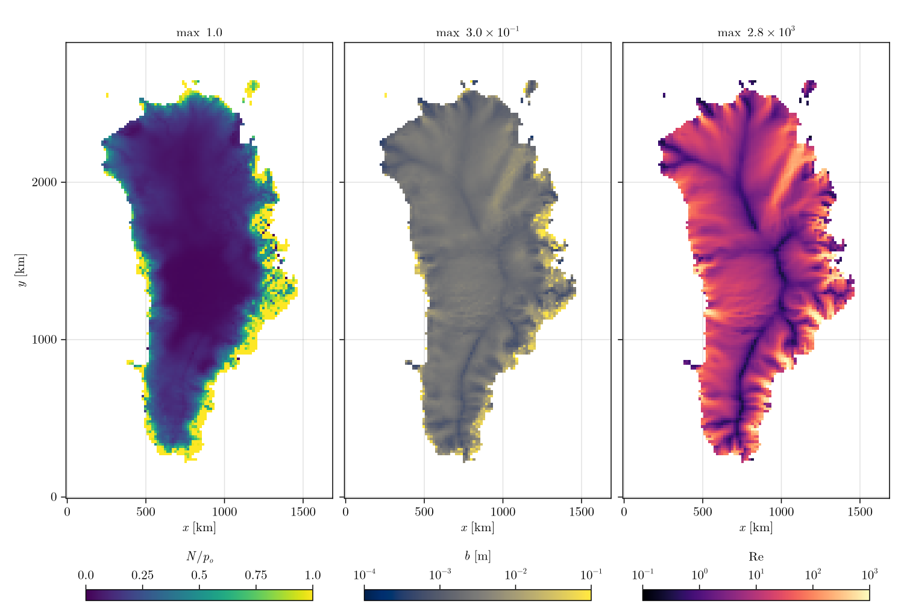
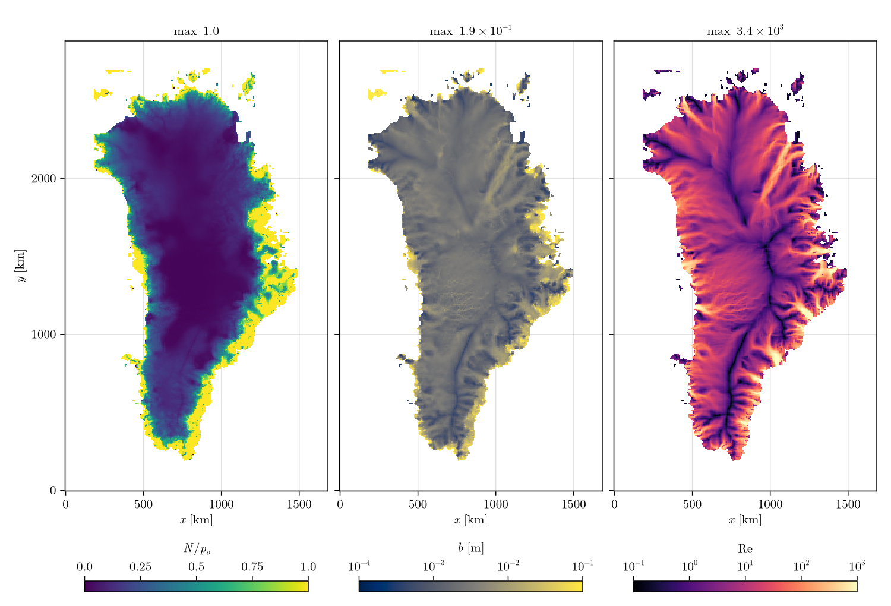

# [Greenland](@id Greenland)

The Greenland Ice Sheet from Yelmo restarts at 16 km and 8 km, the same restarts as the FastHydrology.jl
examples. The default sheet, one year of 1-day steps. The loader is `load_yelmo` in
`docs/make_figures.jl`, which also makes the figures; the restart paths are local
(`docs/figure_paths.jl`).

* Mask: grounded where `f_ice > 0`, `f_grnd > 0` and `H > 0`; ice-free land above sea level is
  `LAND` (an outlet at atmospheric pressure), the rest `OCEAN`. Grounded cells below flotation that
  connect to the ocean are set to `OCEAN`.
* `A` from Yelmo's `ATT` (depth mean, per year to per second), smoothed over three passes;
  `G` from `Q_geo`.
* Sliding: `RegularizedCoulombSlidingLaw(0.25)` with Yelmo's basal speed (`ux_b`, `uy_b`).
* No surface input; the water comes from basal melt.

```julia
using Shakti

d = load_yelmo(restart)                   # (; xc, yc, DX, mask, H, zb, A, G, ub_x, ub_y)
Nx, Ny = size(d.H)
grid = Grid(Nx, Ny, (Nx - 1) * d.DX, (Ny - 1) * d.DX)
sl = RegularizedCoulombSlidingLaw(0.25)
b = fill(1e-3, Nx, Ny)

p = ModelParameters()                     # defaults
state = State(grid)
set_initial_conditions!(state, grid, p, sl, d.mask, d.A, d.zb, d.zb .+ d.H .+ b, b, d.G, d.ub_x, d.ub_y,
                        zeros(Nx, Ny), zeros(Nx + 1, Ny), zeros(Nx, Ny + 1))

ps = PicardSolver(500, 1e-6, CUDSSDirectSolver(grid; structure = :general), grid)   # LUDirectSolver(grid) on CPU
sim = Simulation(grid, state, 365, floattype(86400.0), p, "fully_implicit", ["N", "b", "Re", "po"],
                 ConstantMeltInput(), sl; ps = ps, which_observer = "IO", which_file_writer = "NetCDF",
                 tracked_times = [0, 365], path = "greenland.nc")
run!(sim)
```

| Grid | Cells | Grounded | Steps | `N/p_o` | Mean `N` | Max `b` |
|---|---|---|---|---|---|---|
| 16 km | 106 x 181 | 6 612 | 365 x 1 day | 0 to 1 | 1.93 MPa | 0.30 m |
| 8 km | 211 x 361 | 27 601 | 365 x 1 day | 0 to 1 | 1.86 MPa | 0.20 m |

Wall times are on the [Performance](@ref) page.

## 16 km



## 8 km



In the interior the water pressure is close to the overburden; towards the margins, where the ice
thins and the water drains to `LAND` at atmospheric pressure, `N/p_o` rises to 1. The sheet is
laminar under the divides and turbulent in the outlet systems. The small ice caps detached from the
sheet hold the largest gaps on the 8 km grid. On the 16 km grid one
cell, where the ice is 9 mm thick, ends with a gap larger than the ice thickness.
