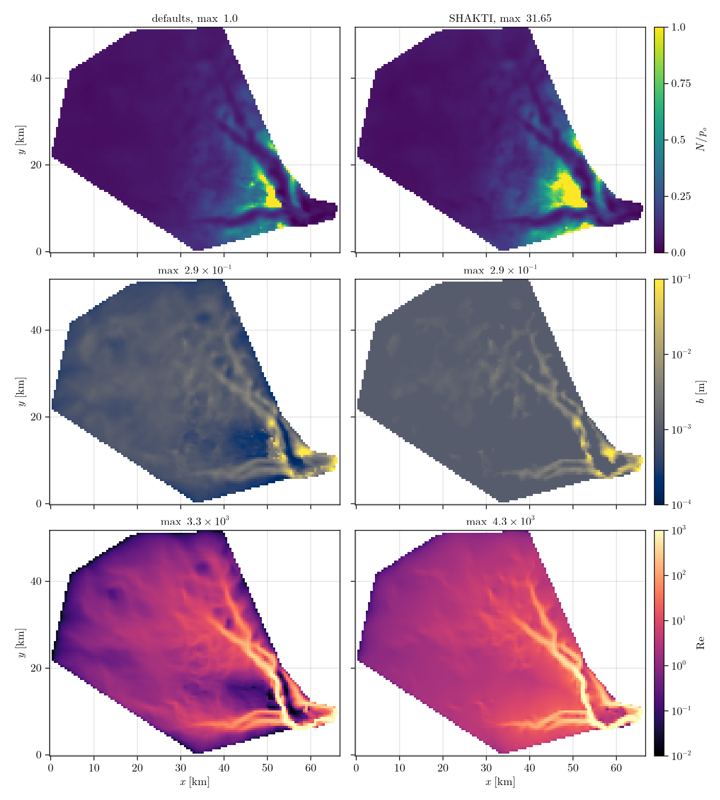

# [Helheim Glacier](@id Helheim)

The winter base state of Helheim Glacier, East Greenland, from the ISSM Shakti setup of
[Sommers2023](@cite): their mesh, geometry, ice hardness and inverted friction coefficient,
rasterized onto a 500 m grid. 90 days of 30-minute steps, with the defaults and with the original
Shakti equations. The loader is `load_helheim` in `docs/make_figures.jl`, which also makes the figure;
the input files are in `docs/src/examples/input/Helheim`.

```julia
using Shakti

# Load the data
d = load_helheim()
# d.xc, d.yc     cell-centre coordinates (m)
# d.DX           grid spacing (m)
# d.mask         GROUNDED / OCEAN / OTHER_BASIN cell types
# d.H, d.zb      ice thickness and bed elevation (m)
# d.A            flow-law parameter A = B^-3 (Pa^-3 s^-1)
# d.G            geothermal heat flux (W m^-2)
# d.ub_x, d.ub_y sliding speed (m s^-1)
# d.C            friction coefficient

# Grid
Nx, Ny = size(d.H)
grid = Grid(Nx, Ny, (Nx - 1) * d.DX, (Ny - 1) * d.DX)

# Sliding law
sl = LinearSlidingLaw(grid, d.C)          # tau_b = C^2 N u_b

# Model parameters
p = ModelParameters(rho_i = 917.0, omega = 1e-3, br = 0.0, lr = 2.0, ct = 0.0,
                    mdot_includes_sensible = false)   # constants of Table 2 of Sommers et al.

# Initial state: a gap of b0 everywhere, the surface above the gap, no surface input
b0 = 1e-3                                 # initial gap height (m)
b  = fill(b0, Nx, Ny)
zs = d.zb .+ d.H .+ b                     # ice surface elevation (m)
state = State(grid)
set_initial_conditions!(state, grid, p, sl, d.mask, d.A, d.zb, zs, b, d.G, d.ub_x, d.ub_y,
                        zeros(Nx, Ny), zeros(Nx + 1, Ny), zeros(Nx, Ny + 1))

# Solver
max_iter = 500                            # Picard iterations per step
tol = 1e-6                                # Picard tolerance
ps = PicardSolver(max_iter, tol, CUDSSDirectSolver(grid; structure = :general), grid)   # LUDirectSolver(grid) on CPU

# Run
nsteps = 4320                             # 90 days
dt = 1800.0                               # 30 minutes (s)
output = ["N", "b", "Re", "po"]           # fields written to file
observer = IOObserver(output, [0, nsteps], NetCDFFileWriter(), "helheim.nc")
sim = Simulation(grid, state, nsteps, floattype(dt), p, ConstantMeltInput(), sl; ps = ps, observer = observer)
run!(sim)
```

For the original equations, add `b_min = 1e-3` to the parameters and
`cavity_filling = FilledCavities(), uplift = NoUplift(), hydraulic_potential = BedPotential(),
gap_coupling = ExplicitGapCoupling()` to `Simulation`.

| Run | Grid | Grounded | Steps | `N/p_o` | Mean `N` | Max `b` | Max `Re` |
|---|---|---|---|---|---|---|---|
| defaults | 134 x 104 | 8 199 | 4320 x 30 min | 0 to 1 | 0.74 MPa | 0.29 m | 3 300 |
| Shakti | 134 x 104 | 8 199 | 4320 x 30 min | -0.02 to 31.6 | 0.84 MPa | 0.29 m | 4 300 |

Wall times are on the [Performance](@ref) page.



* The original equations keep the gap full of water. Where melt cannot fill it, `p_w` goes far
  below zero and `N/p_o` reaches 30. The defaults leave that gap partly empty with `p_w = 0`, so
  `N ≤ p_o` everywhere, and the gap there closes below ``10^{-3}`` m instead of holding at `b_min`, which the original Shakti sets at ``10^{-3}`` m.
* The defaults cost more: more than ten Picard iterations a step at the end against one for the
  original equations.
