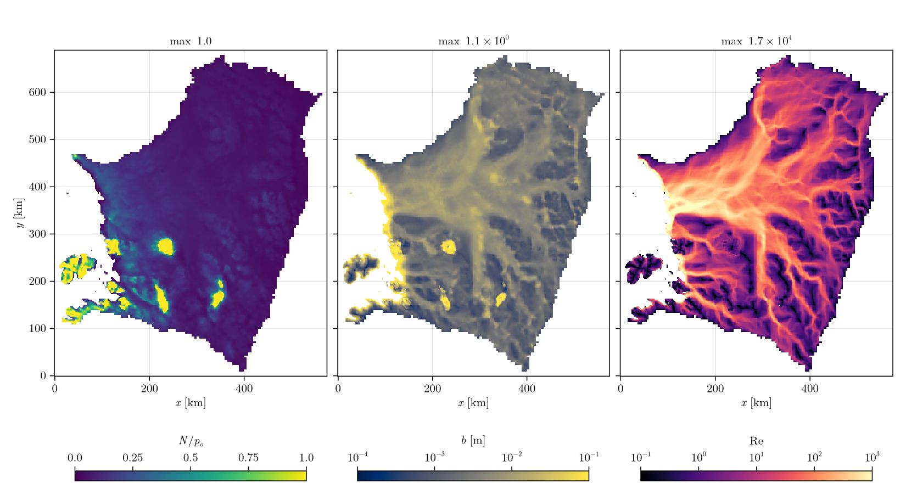

# [Thwaites](@id Thwaites)

Thwaites Glacier on the 2 km grid of [Kazmierczak2024](@cite), with their inverted friction
coefficient. The default sheet, one year of 1-day steps. The loader is `load_thwaites` in
`docs/make_figures.jl`, which also makes the figure.

* The data's `x` and `y` are swapped so the sea is on the left.
* Mask: grounded ice from the data, cells with `H = 0` excluded, grounded cells below flotation that
  connect to the ocean set to `OCEAN`.
* `A` per second, smoothed over three passes (the data has jumps between hardness classes).
* Sliding: the regularized Coulomb law of Kazmierczak et al. with their `C` and `v0`
  (`RegularizedCoulombV0SlidingLaw`), speeds from the SSA velocity.
* No surface input; the water comes from basal melt.

```julia
using Shakti

d = load_thwaites()                       # (; xc, yc, DX, mask, H, zb, A, G, ub_x, ub_y, C, v0)
Nx, Ny = size(d.H)
grid = Grid(Nx, Ny, (Nx - 1) * d.DX, (Ny - 1) * d.DX)
sl = RegularizedCoulombV0SlidingLaw(grid, d.C, d.v0)
b = fill(1e-3, Nx, Ny)

p = ModelParameters()                     # defaults
state = State(grid)
set_initial_conditions!(state, grid, p, sl, d.mask, d.A, d.zb, d.zb .+ d.H .+ b, b, d.G, d.ub_x, d.ub_y,
                        zeros(Nx, Ny), zeros(Nx + 1, Ny), zeros(Nx, Ny + 1))

ps = PicardSolver(500, 1e-6, CUDSSDirectSolver(grid; structure = :general), grid)   # LUDirectSolver(grid) on CPU
sim = Simulation(grid, state, 365, floattype(86400.0), p, ConstantMeltInput(), sl; ps = ps,
                 observer = IOObserver(["N", "b", "Re", "po"], [0, 365], NetCDFFileWriter(), "thwaites.nc"))
run!(sim)
```

| Grid | Grounded cells | Steps | `N/p_o` | Mean `N` | Max `b` |
|---|---|---|---|---|---|
| 288 x 345 | 51 672 | 365 x 1 day | 0 to 1 | 1.67 MPa | 1.08 m |

Wall times are on the [Performance](@ref) page.



Over most of the bed the water pressure is close to the overburden (`N/p_o` near 0), as in
Kazmierczak et al. The water drains through a branching network that converges on the main trunk, where the
flow is turbulent (`Re` up to `10^4`). In the isolated patches at `N/p_o = 1` the gap is open but holds no water, so
`p_w = 0`: unfilled cavities allow this, filled cavities would put a negative `p_w` there.
